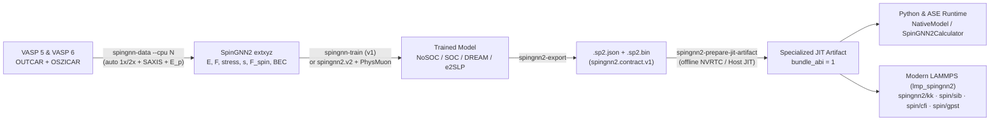

<div align="center">

# SpinGNN2

### Time-Reversal-Equivariant Neural-Network Potentials, Native C++17 / Kokkos Multi-GPU Inference & Modern LAMMPS Spin-Lattice Dynamics

**English** · [简体中文](README_zh.md)

[](https://github.com/Hyyu-Lab/SpinGNN/releases/tag/v2.0.0)
[](LICENSES.md)
[](pyproject.toml)
[](docs/INSTALL_CUDA128.md)
[](libspingnn2/README.md)
[](lammps_spingnn2/README.md)
[](docs/SPINGNN2_GUIDE.md)

[Features](#key-features) · [Skills & Docs](#using-skills-and-docs-together) · [Architecture](#architecture) · [Workflows](#supported-research-workflows) · [Benchmarks](#verified-performance) · [CLI](#command-line-interface) · [Installation](#quick-installation) · [Quick Start](#quick-start) · [Documentation](#documentation) · [Citation](#citation)

</div>

---

**SpinGNN2** is an open-source equivariant machine-learning interatomic potential
(MLIP) and coupled spin–lattice molecular dynamics framework for **magnetic,
polar, ferroelectric, and multiferroic materials**. It spans the full workflow
from parallel VASP 5 & VASP 6 dataset conversion and accelerated PyTorch
training to zero-LibTorch multi-GPU native inference and modern LAMMPS
simulations.

## Key Features

- **Physics-Informed Equivariant Models** — Covers structure-only (`Allegro`),
  Heisenberg/NoSOC (`Allegro_nosoc`, `v2_nosoc`), spin–orbit-coupled SOC
  (`Allegro_soc`, `v2_soc`), DREAM Born effective charges (`Allegro_born`,
  `v2_born`), and e2SLP active-learning uncertainty (`Allegro_e2IP`,
  `Allegro_soc_e2IP`, `v2_e2slp`).
- **Zero-LibTorch Native Multi-GPU Engine (`libspingnn2/`)** — Center-atom-tiled
  C++17 / Kokkos 4.7.02 C ABI library with unified `all-gpu` fat binaries
  (`sm_80`–`sm_120`), offline NVRTC/Host JIT artifacts (`bundle_abi = 1`),
  Stage-1 lattice caching, bucketed CUDA Graph replay, and strict IEEE FP32
  accuracy (**2M atoms on 1× RTX 5090 in 1.58–2.23 GB VRAM**, **99.19% 4-GPU
  weak scaling**).
- **Pure-PyTorch v2 & `PhysMuon` Training (`src/spingnn2/`)** — Zero-`e3nn`
  runtime equivariant primitives (`spingnn2.symmetry`, `spingnn2.v2`) with
  full-graph `torch.compile` and CUDA-Graphed **`PhysMuon` / `Muon`**
  optimizers (**3.3×–11.4× faster**, **−71% to −91% peak VRAM**; also built
  into `spingnn-train`).
- **Modern LAMMPS Spin–Lattice MD & GPST (`lammps_spingnn2/`)** — External
  overlay for upstream LAMMPS (`stable_30Sep2026_update1`) providing
  `pair_style spingnn2(/kk)`, Kokkos `fix spin/sib(/npt)/kk`, 1-eval/step
  `fix spin/cfi(/kk)` with isotropic `box iso` NPT, DREAM `atom_style bec` /
  `fix efield coupling bec`, e2SLP `fix pair`, and `compute spin/gpst(/kk)` +
  offline `spingnn2.gpst` C99 OpenMP analysis CLIs.
- **Parallel Converged-Only VASP 5 & VASP 6 Converter & Unified CLIs** —
  Multi-core (`spingnn-data --cpu N`, spawn-safe) VASP 5/6 `OUTCAR`/`OSZICAR` →
  `extxyz` pipeline with automatic `1×`/`2×` spin-force detection, `SAXIS`
  rotation, and $E_p$ subtraction across a unified `spingnn-*` / `spingnn2-*`
  CLI namespace.
- **Built-In Complete `skills/` & `docs/`** — Ships comprehensive technical
  documentation ([`docs/`](docs/README.md)) and 8 ready-to-use AI coding
  assistant skills ([`skills/`](skills/README.md)) covering every stage from
  installation and data preparation to training, export, and LAMMPS MD.

### Using `skills/` and `docs/` Together

> [!TIP]
> **Recommended workflow:** SpinGNN2 ships a complete, synchronized pair of
> [**`skills/`**](skills/README.md) (8 executable workflows for AI coding
> assistants such as Codex, Claude Code, Antigravity, and Cursor) and
> [**`docs/`**](docs/README.md) (user guide, architecture, build instructions,
> verified hardware limits, and benchmarks). Install all skills in one command
> and combine them with `docs/` directly:

```bash
# Install all 8 SpinGNN2 skills for your AI coding assistant(s)
npx skills add Hyyu-Lab/SpinGNN

# Or one-shot non-interactive global install for all agents:
npx skills add Hyyu-Lab/SpinGNN --all -g

# List available skills or install specific skill(s) only:
npx skills add Hyyu-Lab/SpinGNN --list
npx skills add Hyyu-Lab/SpinGNN --skill spingnn-install --skill spingnn2 -g -y
```

- **AI-assisted workflows**: After installing, ask your assistant to use
  `spingnn-install` (setup), `spingnn2` (native export, JIT & modern LAMMPS),
  `spingnn-usage` (VASP data & training reference), or any task-specific E2E
  skill in [Supported Research Workflows](#supported-research-workflows).
- **Detailed contracts & benchmarks**: Pair any skill with the
  [SpinGNN2 User Guide](docs/SPINGNN2_GUIDE.md), [INSTALL.md](INSTALL.md),
  [Validation Summary](docs/VALIDATION.md), and [Performance Benchmarks](docs/PERFORMANCE.md).

<div align="center">

| Single-GPU Capacity (RTX 5090) | 4-GPU LAMMPS Weak Scaling | v2 Training Speedup (`PhysMuon`) | Deployment Footprint |
| :---: | :---: | :---: | :---: |
| **2,000,000 atoms** | **99.19% efficiency** | **3.3× – 11.4× faster** | **Zero LibTorch** |
| 1.58 – 2.23 GB peak VRAM (strict IEEE FP32) | 2.05M atoms on 4× RTX 5090 | −70.9% to −91.4% peak VRAM | Unified `sm80`–`sm120` fat binary |

</div>

---

## Architecture



---

## Supported Research Workflows

| Research Goal | Typical Materials | Model Builders | Native Engine & Modern LAMMPS | YAML Template | AI Skill |
| :--- | :--- | :--- | :---: | :---: | :---: |
| **Structure-only potentials** (energy, forces, stress) | Metals, semiconductors, oxides | `Allegro`, `Allegro_e2IP` | **Yes (`Allegro_e2IP`)** | [01](example/01_structure_only.yaml), [06](example/06_allegro_e2ip.yaml) | [structure-only-e2e](skills/structure-only-e2e/SKILL.md) |
| **Magnetic potentials without SOC** (Heisenberg exchange) | 3d transition-metal magnets (Fe, Co, Ni, Mn, Cr) | `Allegro_nosoc`, `v2_nosoc` | **Yes** | [02](example/02_spin_nosoc.yaml) | [spin-nosoc-e2e](skills/spin-nosoc-e2e/SKILL.md) |
| **Magnetic potentials with SOC** (anisotropy, DMI, non-collinear) | Heavy-element / 4d–5f magnets | `Allegro_soc`, `v2_soc` | **Yes** | [03](example/03_spin_soc.yaml), [05](example/05_spin_soc_production.yaml) | [spin-soc-e2e](skills/spin-soc-e2e/SKILL.md) |
| **Electric-field MD & Born effective charges** (**DREAM**) | Ferroelectrics, polar crystals, multiferroics | `Allegro_born`, `v2_born` | **Yes** | [04](example/04_born_effective_charge.yaml) | [born-effective-charge-e2e](skills/born-effective-charge-e2e/SKILL.md) |
| **Active learning & uncertainty scoring** (**e2SLP**) | Magnetic & structural MD trajectories | `Allegro_e2IP`, `Allegro_soc_e2IP`, `v2_e2slp` | **Yes** | [06](example/06_allegro_e2ip.yaml), [07](example/07_allegro_soc_e2ip.yaml) | [e2slp-evaluation](skills/e2slp-evaluation/SKILL.md) |

---

## Verified Performance

All measurements below were collected on **NVIDIA RTX 5090 (32 GB, `sm120`, CUDA 12.8)**
and **RTX 4090 (`sm89`)** with 56 directed neighbors per atom under strict IEEE FP32
(`CUBLAS_COMPUTE_32F`) and prepared JIT artifacts. Full protocols, RTX 4090 tables,
and opt-in TF32 measurements are documented in
[docs/PERFORMANCE.md](docs/PERFORMANCE.md) and [docs/VALIDATION.md](docs/VALIDATION.md).

### 1. Direct Native Inference (Strict IEEE FP32, RTX 5090)

Latency in **µs/atom** at 32,768 atoms and 2,000,000 atoms (112M directed edges,
`capacity` profile). PyTorch eager OOMed at 32,768 atoms for all three models.

| Model | PyTorch Eager (4,096) | Native 32,768 (Baseline → Optimized) | Native 2,000,000 | Peak VRAM @ 2M Atoms |
| :--- | ---: | ---: | ---: | ---: |
| `Allegro_nosoc` (`mul=16`) | 21.88 µs (24.3 GiB) | 4.48 → **3.77 µs** (**1.19×**) | **4.63 µs** | **1.58 GB** |
| `Allegro_soc` (`mul=16`) | 34.98 µs (18.9 GiB) | 10.69 → **9.15 µs** (**1.17×**) | **9.52 µs** | **2.23 GB** |
| `Allegro_born` (DREAM) | 20.43 µs (13.7 GiB) | 4.17 → **3.94 µs** (**1.06×**) | **4.13 µs** | **2.01 GB** |
| `Allegro_soc` prod (`mul=32`) | — | 52.98 → **42.33 µs** (**1.25×**) | — | — |

### 2. SpinGNN2 v2 `torch.compile` + `PhysMuon` Training vs v1 Adam

Pure-PyTorch `spingnn2.symmetry` + `spingnn2.v2` (zero `e3nn` runtime dependency,
edge `bfloat16` AMP, selective checkpointing, whole-step CUDA-Graphed 5-step quintic
`PhysMuon`) vs SpinGNN++ v1 Adam on matched 512-atom / 14,958-edge supercells
([`benchmarks/bench_v2_train.py`](benchmarks/bench_v2_train.py)):

| Model Family | `dynamic=True` Speedup (0 Recompiles) | Capped-Bucket (`<=4`) Speedup | Peak VRAM Reduction (Alloc / Reserved) |
| :--- | ---: | ---: | ---: |
| `nosoc` (RTX 5090) | **3.29×** (`2.76×` on 4090) | **7.91×** (`7.65×` on 4090) | **−91.4% / −85.1%** |
| `soc` (RTX 5090) | **3.42×** (`3.16×` on 4090) | **9.06×** (`11.45×` on 4090) | **−85.8% / −70.9%** |
| `born` DREAM (RTX 5090) | **3.80×** (`3.96×` on 4090) | **8.15×** (`10.26×` on 4090) | **−88.4% / −75.4%** |
| `e2slp` (RTX 4090) | **3.32×** (`3.32×–3.66×` 64→512) | **9.20×** (`9.20×–9.55×`) | **−88.6% / −80.8%** |

### 3. Multi-GPU Weak Scaling & Thermal MD in Modern LAMMPS (RTX 5090)

Full-width `Allegro_nosoc`, strict IEEE FP32, 512,000 atoms/GPU (10 NVE steps @ 0.02 fs,
1 MPI rank per physical GPU UUID):

| RTX 5090 GPUs | Total Atoms | Seconds / 10 Steps | Weak Scaling Efficiency | Energy Drift Range (eV/atom) |
| ---: | ---: | ---: | ---: | ---: |
| 1 | 512,000 | 33.0036 | 100.00% | 1.93e-07 |
| 2 | 1,024,000 | 33.1692 | 99.50% | 2.11e-07 |
| 4 | 2,048,000 | 33.2721 | **99.19%** | 1.74e-07 |

<details>
<summary><b>Thermal 300 K LAMMPS MD Throughput (4,096 atoms/1× RTX 5090 &amp; 4-GPU multi-node)</b></summary>

Displacement-triggered neighbor rebuilds with GPU physical-edge compaction (zero dangerous builds):

| Integrator | Timestep | Skin | Steps/s | ns/day | Mean Kinetic Temp |
| :--- | ---: | ---: | ---: | ---: | ---: |
| NVE | 1.0 fs | 0.4 Å | 43.43 | 3.753 | 323 K |
| NVE | 1.0 fs | 1.5 Å | 43.77 | 3.781 | 323 K |
| Moving SIB | 0.5 fs | 0.4 Å | 28.34 | 1.224 | 329 K |
| Moving SIB | 0.5 fs | 1.5 Å | 28.40 | 1.227 | 329 K |

At 300 K with 8,000 atoms/GPU (0.4 Å skin), 4-GPU single-node and 2-node (2 GPUs/node)
runs sustained **22.15–22.17 steps/s** (1.914–1.915 ns/day) in NVE and
**14.32–14.33 steps/s** (0.618–0.619 ns/day) in moving SIB.

</details>

---

## Command-Line Interface

All SpinGNN2 commands use a unified `spingnn-*` / `spingnn2-*` namespace (and can
also be invoked directly from a source checkout via `python tools/ci/source_python.py <cmd>`):

| Stage | Command | Purpose |
| :--- | :--- | :--- |
| **Data Prep** | `spingnn-data` | Multi-core VASP 5 & VASP 6 `OUTCAR`/`OSZICAR` → `extxyz` (`--cpu N`, auto 1×/2×, `SAXIS`, $E_p$, BEC) |
| | `spingnn-data-mlff` / `spingnn-data-mlff-bec` / `spingnn-data-delta-mag` | Specialized MLFF, indexed BEC, and $\Delta$-magnetic dataset builders |
| **Training** | `spingnn-train` | Train or restart SpinGNN++ / DREAM / e2SLP models (supports `PhysMuon` / `Muon` & `cuda_graph`) |
| | `spingnn-evaluate` / `spingnn-benchmark` | Evaluate test-set metrics or benchmark inference throughput |
| **Deployment** | `spingnn2-export` | Export trained checkpoint to portable `.sp2.json` + `.sp2.bin` contract |
| | `spingnn2-prepare-jit-artifact` | Pre-compile model-specialized NVRTC/Host JIT artifact offline (`bundle_abi = 1`) |
| | `spingnn-deploy` | Legacy TorchScript / PT2 deployment (`build`, `build-pt2`, `info`) |
| **Spin Analysis** | `spingnn2-gpst-moments` / `spingnn2-gpst-infer` | First-party C99 OpenMP GPST spin-temperature moments & inference CLI |

---

## Quick Installation

### 1. Training Environment (PyTorch 2.11 + CUDA 12.8 + T-e3nn)

```bash
tools/ci/install.sh --gpu auto      # or: --gpu h100|a100|4090|5090|cpu
source validation/env/spingnn-cu128/bin/activate
```

### 2. Native Library, Python/ASE Package & Modern LAMMPS (`lmp_spingnn2`)

SpinGNN2 native inference requires **no PyTorch or LibTorch** on execution hosts.

```bash
# Build native C ABI library (libspingnn2.so) for Python/ASE
python tools/native/build_native.py --prepare-dependencies
python tools/native/build_native.py --backend cpu
# Multi-GPU fat binary (sm80 A100/A800, sm86, sm89 4090, sm90 H100/H800, sm120 5090):
python tools/native/build_native.py --backend cuda --arch all-gpu --cuda-root /data/app/cuda/12.8
# Or single architecture (sm80 | sm86 | sm89 | sm90 | sm120):
python tools/native/build_native.py --backend cuda --arch sm120 --cuda-root /data/app/cuda/12.8

# Install the SpinGNN2 Python package (root pyproject.toml, src/ layout)
pip install .                # NumPy + SciPy + NativeModel + spingnn2.symmetry/v2/gpst/data
pip install '.[ase]'         # adds SpinGNN2Calculator & spingnn-data extxyz I/O

# Build modern LAMMPS (stable_30Sep2026_update1) + libspingnn2 + wheel in one command
python tools/spingnn2_build.py --target all-gpu   # or: --target cpu | sm80 | sm86 | sm89 | sm90 | sm120
```

Keep the installed `bin/` and its sibling `lib*` directory together, and verify
embedded RPATHs with:

```bash
env -i PATH=/usr/bin:/bin /path/to/install/bin/lmp_spingnn2 -h
```

See [INSTALL.md](INSTALL.md) for manual overlay steps (`lammps_spingnn2/apply.py`),
custom compiler/CUDA paths, and container builds ([docker/README.md](docker/README.md)).

---

## Quick Start

### Step 1 — Prepare Data, Train, Export & Pre-Compile JIT Artifact

```bash
# 0. Convert converged VASP 5 / VASP 6 constrained-M runs in parallel across 8 CPU cores
python tools/ci/source_python.py spingnn-data -m \
  --path /path/to/vasp-runs --out-path data/magnetic.extxyz --cpu 8

# 1. Train a SpinGNN++ model (example: NoSOC magnetic potential)
python tools/ci/source_python.py spingnn-train example/02_spin_nosoc.yaml

# 2. Export checkpoint to compact SpinGNN2 contract (.sp2.json + .sp2.bin)
mkdir -p deployed
python tools/ci/source_python.py spingnn2-export \
  results/spin_nosoc/example -o deployed/spin_nosoc

# 3. Pre-compile model-specialized JIT artifact once (offline, before MD)
ARTIFACT=$(python tools/ci/source_python.py spingnn2-prepare-jit-artifact \
  --model deployed/spin_nosoc.sp2.json \
  --backend cuda --arch sm120 --precision float32)
echo "Prepared manifest: $ARTIFACT"
```

### Step 2 — Run in Python / ASE (Zero PyTorch Required on Execution Host)

```python
from spingnn2.native import NativeModel
from spingnn2.calculator import SpinGNN2Calculator

with NativeModel.load(
    "deployed/spin_nosoc.sp2.json",
    backend="cuda",
    precision="float32",
    execution_mode="direct",
    artifact=artifact_manifest,
    execution_profile="speed",
    radial_mode="spline",
) as model:
    outputs = model.evaluate(graph)
    with model.evaluate_stage1_lattice(graph, spin_only=True) as lattice:
        frozen = model.evaluate_stage2_spin_cached(lattice, new_spins, spin_only=True)

# Or via ASE:
atoms.calc = SpinGNN2Calculator(
    "deployed/spin_nosoc.sp2.json",
    backend="cuda",
    precision="float32",
    execution_mode="direct",
    artifact=artifact_manifest,
    radial_mode="spline",
)
energy, forces = atoms.get_potential_energy(), atoms.get_forces()
```

### Step 3 — Run in Modern LAMMPS (`lmp_spingnn2`)

```lammps
units       metal
boundary    p p p
atom_style  spin
atom_modify map array
read_data   system-spin.data

pair_style  spingnn2 precision float32 math ieee profile yes
pair_coeff  * * deployed/spin_nosoc.sp2.json prepared-artifact.json Mn Ge

fix         integrate all spin/sib 300.0 0.1 91081 lattice moving
# Or 1-eval/step Cached-Field Integrator (supports canonical `box iso P W [box_ou]` NPT):
# fix       integrate all spin/cfi 300.0 0.1 91081 lattice moving
compute     timers all spingnn2/timing
compute     gpst all spin/gpst cutoff 5.0
thermo_style custom step temp pe etotal c_timers[*]
timestep    0.0001
run         100
```

Launch on 4 GPUs with Kokkos CUDA and one MPI rank per physical GPU UUID
(use `-pk kokkos gpu/aware off neigh half` on non-GPU-aware MPI stacks):

```bash
mpirun -n 4 tools/lammps/spingnn2_gpu_rank.py \
  /path/to/install/bin/lmp_spingnn2 \
  -k on g 1 -sf kk -pk kokkos gpu/aware on neigh half \
  -in in.spin_md
```

> See the complete [SpinGNN2 User Guide](docs/SPINGNN2_GUIDE.md) for DREAM `BEC`,
> e2SLP `fix pair` uncertainty readouts, `fix spin/sib/npt`, `fix spin/cfi`
> (`box iso P W [box_ou]`), `compute spin/gpst`, CPU/OpenMP Kokkos launches, and
> [Verified Configuration and Hardware Limits](docs/SPINGNN2_GUIDE.md#7-verified-configuration-and-hardware-limits).

---

## Repository Layout

| Path | Contents | License |
| :--- | :--- | :---: |
| [`src/spingnn2/`](src/spingnn2/) | SpinGNN2 Python package: magnetic symmetry (`symmetry/`), pure-`torch.compile` v2 models (`v2/`), VASP 5 & 6 converter (`data/`), `.sp2.json`/`.sp2.bin` exporter, offline JIT preparer, `NativeModel`, `SpinGNN2Calculator`, and GPST toolkit (`gpst/`) | MIT |
| [`src/core/`](src/core/) | Core data, equivariant training engine, and `spingnn-{train,evaluate,benchmark,deploy}` CLIs (`nequip` package) | MIT |
| [`src/models/`](src/models/) | Local SpinGNN++ v1, DREAM BEC, and e2SLP models (`allegro` package) | MIT |
| [`libspingnn2/`](libspingnn2/) | Native C++17 / Kokkos 4.7.02 C ABI inference library (`libspingnn2.so`) & NVRTC preparation library | MIT |
| [`lammps_spingnn2/`](lammps_spingnn2/) | External overlay & patches for modern LAMMPS `stable_30Sep2026_update1` (`spingnn2(/kk)`, `spin/sib(/npt)/kk`, `spin/cfi(/kk)`, `spin/gpst(/kk)`, DREAM `BEC`) | GPL-2.0 |
| [`example/`](example/) | Starting YAML templates (01–07) and training tutorials | MIT |
| [`skills/`](skills/) | End-to-end AI assistant skills for setup, data prep, training, export, and MD | MIT |
| [`docs/`](docs/) | User guide, architecture roadmap, validation and performance reports | MIT |
| [`docker/`](docker/) | CUDA 12.8 container recipe | MIT |
| [`tools/`](tools/) | Installers, `spingnn2_build.py`, `build_native.py`, `spingnn2_gpu_rank.py`, e2SLP evaluator, and CI utilities | MIT |
| [`tests_native/`](tests_native/), [`tests_v2/`](tests_v2/), [`tests_ci/`](tests_ci/), [`benchmarks/`](benchmarks/) | Native/LAMMPS/VASP qualification suites, v2 symmetry/training tests, CI control-plane tests, and benchmarks | MIT |

See [LICENSES.md](LICENSES.md) and [THIRD_PARTY_LICENSES.md](THIRD_PARTY_LICENSES.md)
for component notices and redistribution terms (including GPL-2.0 obligations for
distributed LAMMPS binaries).

---

## Documentation

Start from the [Documentation Index](docs/README.md):

| Topic | Guides & References |
| :--- | :--- |
| **Core Guides** | [SpinGNN2 User Guide](docs/SPINGNN2_GUIDE.md) · [Architecture & Roadmap](docs/ARCHITECTURE_ROADMAP.md) · [Python/ASE Runtime](src/spingnn2/README.md) · [Native C ABI Library](libspingnn2/README.md) · [Modern LAMMPS Overlay](lammps_spingnn2/README.md) |
| **Validation & Performance** | [Validation Summary](docs/VALIDATION.md) · [Performance Benchmarks](docs/PERFORMANCE.md) |
| **Installation & Environments** | [INSTALL.md](INSTALL.md) · [CUDA 12.8 Guide](docs/INSTALL_CUDA128.md) · [Source Checkout](docs/SOURCE_CHECKOUT.md) · [T-e3nn Integration](docs/TE3NN_INTEGRATION.md) · [Docker](docker/README.md) |
| **Training & Models** | [Examples](example/README.md) · [Training Tutorial](example/TUTORIAL_TRAINING.md) · [e2SLP Guide](example/E2IP.md) |
| **AI Skills & Development** | [Skills Index](skills/README.md) · [CI & Testing](tools/ci/README.md) · [Contributing](CONTRIBUTING.md) |

---

## Citation

If you use SpinGNN2 in your research, please cite the papers relevant to your
workflow. Machine-readable records are provided in [CITATION.bib](CITATION.bib)
and [CITATION.cff](CITATION.cff).

1. **SpinGNN**: H. Yu, Y. Zhong, L. Hong, C. Xu, W. Ren, X. Gong, and H. Xiang,
   “Spin-dependent graph neural network potential for magnetic materials,”
   *Physical Review B* **109**, 144426 (2024).
   [DOI: 10.1103/PhysRevB.109.144426](https://doi.org/10.1103/PhysRevB.109.144426)
2. **SpinGNN++**: H. Yu, B. Liu, Y. Zhong, L. Hong, J. Ji, C. Xu, X. Gong, and H. Xiang,
   “Physics-informed time-reversal equivariant neural network potential for
   magnetic materials,” *Physical Review B* **110**, 104427 (2024).
   [DOI: 10.1103/PhysRevB.110.104427](https://doi.org/10.1103/PhysRevB.110.104427)
3. **DREAM**: H. Yu, S. Deng, H. Zhu, M. Xie, Y. Zhang, X. Shi, J. Zhong, C. He, and H. Xiang,
   “Prediction of Room Temperature Ferroelectricity in Subnano Silicon Thin Films
   with an Antiferroelectric Ground State,” *Physical Review Letters* **135**,
   156801 (2025).
   [DOI: 10.1103/xlkt-4wk5](https://doi.org/10.1103/xlkt-4wk5)
4. **e2SLP**: Y. Cheng, H. Yu, and H. Xiang,
   “Tangent-plane evidential uncertainty in active learning for magnetic
   interatomic potentials,” *Physical Review Materials* **10**, 103807 (2026).
   [DOI: 10.1103/PhysRevMaterials.10.103807](https://doi.org/10.1103/PhysRevMaterials.10.103807) · [arXiv:2605.12353](https://arxiv.org/abs/2605.12353)
5. **PhysMuon**: Y. Hu, H. Xiang, X. Gong, and H. Yu,
   “A Physical Response-and-Memory Model for Muon Optimization,”
   *arXiv preprint* (2026).
   [arXiv:2608.22994](https://arxiv.org/abs/2608.22994)
6. **GPST & CFI**: Y. Zheng, L. Hong, X. Gong, H. Xiang, and H. Yu,
   “Efficient spin-lattice dynamics and spin thermometry with machine-learned
   magnetic potentials,” *arXiv preprint* (2026).
   [arXiv:2611.32129](https://arxiv.org/abs/2611.32129)

### Contributors & Project Leadership

| Role | Members |
| :--- | :--- |
| **Code Contributors** | Hongyu Yu (Fudan University) · Yang Cheng (Fudan University) · Jinyu Liu (Fudan University) |
| **Project Leaders** | Xingao Gong (Fudan University) · Hongjun Xiang (Fudan University) · Hongyu Yu (Fudan University) |
