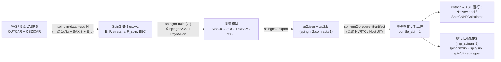

<div align="center">

# SpinGNN2

### 时间反演等变神经网络势、原生 C++17 / Kokkos 多 GPU 推理与现代 LAMMPS 自旋-晶格动力学框架

[English](README.md) · **简体中文**

[](https://github.com/Hyyu-Lab/SpinGNN/releases/tag/v2.0.0)
[](LICENSES.md)
[](pyproject.toml)
[](docs/INSTALL_CUDA128.md)
[](libspingnn2/README.md)
[](lammps_spingnn2/README.md)
[](docs/SPINGNN2_GUIDE.md)

[核心特性](#核心特性) · [Skills 与文档](#结合使用-skills-与-docs) · [整体架构](#整体架构) · [研究工作流](#支持的研究工作流) · [性能基准](#实测性能基准) · [命令行工具](#命令行接口) · [快速安装](#快速安装) · [快速开始](#快速开始) · [文档索引](#文档索引) · [引用](#引用)

</div>

---

**SpinGNN2** 是一个面向**磁性、极性、铁电及多铁性材料**的开源等变机器学习原子间势（MLIP）与自旋-晶格耦合分子动力学框架。项目覆盖从多核并行 VASP 5 & VASP 6 数据构建、加速 PyTorch 训练，到零 LibTorch 原生多 GPU 推理与现代 LAMMPS 大规模模拟的完整工作流。

## 核心特性

- **物理先验等变势模型家族** — 完整支持纯结构（`Allegro`）、无自旋-轨道耦合海森堡磁性（`Allegro_nosoc`、`v2_nosoc`）、含 SOC 磁性（`Allegro_soc`、`v2_soc`）、DREAM 玻恩有效电荷（`Allegro_born`、`v2_born`）以及 e2SLP 主动学习不确定度模型（`Allegro_e2IP`、`Allegro_soc_e2IP`、`v2_e2slp`）。
- **零 LibTorch 原生多 GPU 推理引擎（`libspingnn2/`）** — 基于中心原子分块的 C++17 / Kokkos 4.7.02 C ABI 引擎，支持统一 `all-gpu` 多架构胖二进制（`sm_80`–`sm_120`）、离线 NVRTC / Host JIT 工件（`bundle_abi = 1`）、Stage-1 晶格缓存、分桶 CUDA Graph 重放与严格 IEEE FP32 精度（**单张 RTX 5090 可承载 200 万原子，峰值显存仅 1.58–2.23 GB；4 卡弱扩展效率达 99.19%**）。
- **纯 PyTorch v2 与 `PhysMuon` 加速训练（`src/spingnn2/`）** — 零 `e3nn` 运行时依赖的等变原语（`spingnn2.symmetry`、`spingnn2.v2`），支持全图 `torch.compile` 与整步 CUDA Graph 化的 **`PhysMuon` / `Muon`** 优化器（**速度提升 3.3×–11.4×，峰值显存降低 71%–91%**；同时已原生集成至 `spingnn-train` v1 YAML 训练器）。
- **现代 LAMMPS 自旋-晶格动力学与 GPST（`lammps_spingnn2/`）** — 面向官方上游 LAMMPS（`stable_30Sep2026_update1`）的外部插件覆盖层，提供 `pair_style spingnn2(/kk)`、Kokkos 原生 `fix spin/sib(/npt)/kk`、每步单次势能求值的 `fix spin/cfi(/kk)`（支持各向同性 `box iso` NPT）、DREAM `atom_style bec` / `fix efield coupling bec`、e2SLP `fix pair` 读取，以及 `compute spin/gpst(/kk)` 与离线 C99 OpenMP `spingnn2.gpst` 自旋温度分析工具。
- **多核并行收敛态 VASP 5 & VASP 6 数据管道与统一 CLI** — 多核并行（`spingnn-data --cpu N`，`spawn` 安全）`OUTCAR`/`OSZICAR` → `extxyz` 转换器，仅收集收敛后的最终步，自动识别 VASP 5（`1×` → `×2`）与 VASP 6（`2×` → `×1`）及 Mode 4 线性罚项，自动执行 `SAXIS` 旋转与一致的 $E_p$ 扣除；全流程统一使用 `spingnn-*` / `spingnn2-*` 命令行接口。
- **完备同步的 `skills/` 与 `docs/` 体系** — 仓库内置详尽技术文档（[`docs/`](docs/README.md)）与 8 个端到端 AI 编程助手 Skills（[`skills/`](skills/README.md)），覆盖环境安装、VASP 数据准备、模型训练、导出、离线 JIT 编译与 LAMMPS 模拟。

### 结合使用 `skills/` 与 `docs/`

> [!TIP]
> **推荐使用方式：** 本仓库已配备完备且实时同步的 [**`skills/`**](skills/README.md)（面向 Codex、Claude Code、Antigravity、Cursor 等 AI 编程助手的 8 套可执行工作流）与 [**`docs/`**](docs/README.md)（完整用户手册、架构设计、构建说明、实测硬件极限与性能基准）。一条命令即可安装全部 Skills，并结合 `docs/` 直接上手：

```bash
# 交互式安装全部 8 个 SpinGNN2 Skills（自动检测已安装的 AI 编程助手）
npx skills add Hyyu-Lab/SpinGNN

# 或一键非交互式全局安装到所有检测到的助手：
npx skills add Hyyu-Lab/SpinGNN --all -g

# 预览全部可用 Skills 或仅安装指定 Skill：
npx skills add Hyyu-Lab/SpinGNN --list
npx skills add Hyyu-Lab/SpinGNN --skill spingnn-install --skill spingnn2 -g -y
```

- **AI 助手驱动全流程**：安装后可直接让助手调用 `spingnn-install`（环境与 LAMMPS 安装）、`spingnn2`（原生导出、离线 JIT 与现代 LAMMPS）、`spingnn-usage`（VASP 数据与训练命令参考），或下表中的任一任务端到端 Skill。
- **查阅详细契约与基准**：可随时配合查阅 [SpinGNN2 用户指南](docs/SPINGNN2_GUIDE.md)、[INSTALL.md](INSTALL.md)、[验证报告](docs/VALIDATION.md) 与 [性能基准](docs/PERFORMANCE.md)。

<div align="center">

| 单卡承载上限（RTX 5090） | 4 卡 LAMMPS 弱扩展 | v2 训练加速（`PhysMuon`） | 部署依赖 footprint |
| :---: | :---: | :---: | :---: |
| **2,000,000 原子** | **99.19% 扩展效率** | **3.3× – 11.4× 加速** | **零 LibTorch** |
| 1.58 – 2.23 GB 峰值显存（严格 IEEE FP32） | 4× RTX 5090 运行 205 万原子 | 显存降低 70.9% – 91.4% | 统一 `sm80`–`sm120` 胖二进制 |

</div>

---

## 整体架构



---

## 支持的研究工作流

| 研究目标 | 典型材料体系 | 模型构建器 | 原生引擎与现代 LAMMPS | YAML 模板 | AI Skill |
| :--- | :--- | :--- | :---: | :---: | :---: |
| **纯结构势函数**（能量、力、应力） | 金属、半导体、氧化物 | `Allegro`, `Allegro_e2IP` | **支持（`Allegro_e2IP`）** | [01](example/01_structure_only.yaml), [06](example/06_allegro_e2ip.yaml) | [structure-only-e2e](skills/structure-only-e2e/SKILL.md) |
| **无 SOC 磁性势**（海森堡交换作用） | 3d 过渡金属磁性材料（Fe, Co, Ni, Mn, Cr） | `Allegro_nosoc`, `v2_nosoc` | **支持** | [02](example/02_spin_nosoc.yaml) | [spin-nosoc-e2e](skills/spin-nosoc-e2e/SKILL.md) |
| **含 SOC 磁性势**（各向异性、DMI、非共线） | 重元素 / 4d–5f 磁性材料 | `Allegro_soc`, `v2_soc` | **支持** | [03](example/03_spin_soc.yaml), [05](example/05_spin_soc_production.yaml) | [spin-soc-e2e](skills/spin-soc-e2e/SKILL.md) |
| **电场 MD 与玻恩有效电荷**（**DREAM**） | 铁电体、极性晶体、多铁材料 | `Allegro_born`, `v2_born` | **支持** | [04](example/04_born_effective_charge.yaml) | [born-effective-charge-e2e](skills/born-effective-charge-e2e/SKILL.md) |
| **主动学习与不确定度评估**（**e2SLP**） | 磁性与结构分子动力学轨迹 | `Allegro_e2IP`, `Allegro_soc_e2IP`, `v2_e2slp` | **支持** | [06](example/06_allegro_e2ip.yaml), [07](example/07_allegro_soc_e2ip.yaml) | [e2slp-evaluation](skills/e2slp-evaluation/SKILL.md) |

---

## 实测性能基准

以下数据均在 **NVIDIA RTX 5090（32 GB，`sm120`，CUDA 12.8）** 与 **RTX 4090（`sm89`）** 上测得，单原子平均 56 个有向近邻，默认使用严格 IEEE FP32（`CUBLAS_COMPUTE_32F`）与离线 JIT 工件。完整测试协议、RTX 4090 明细表及可选 TF32 数据请参阅 [docs/PERFORMANCE.md](docs/PERFORMANCE.md) 与 [docs/VALIDATION.md](docs/VALIDATION.md)。

### 1. 原生直接推理性能（严格 IEEE FP32，RTX 5090）

单位为 **µs/atom**（32,768 原子及 2,000,000 原子 / 1.12 亿有向边，`capacity` 模式）。PyTorch eager 在 32,768 原子规模下三类模型均触发 OOM。

| 模型 | PyTorch Eager（4,096 原子） | 原生 32,768（基线 → 优化） | 原生 2,000,000 原子 | 200 万原子峰值显存 |
| :--- | ---: | ---: | ---: | ---: |
| `Allegro_nosoc`（`mul=16`） | 21.88 µs (24.3 GiB) | 4.48 → **3.77 µs**（**1.19×**） | **4.63 µs** | **1.58 GB** |
| `Allegro_soc`（`mul=16`） | 34.98 µs (18.9 GiB) | 10.69 → **9.15 µs**（**1.17×**） | **9.52 µs** | **2.23 GB** |
| `Allegro_born`（DREAM） | 20.43 µs (13.7 GiB) | 4.17 → **3.94 µs**（**1.06×**） | **4.13 µs** | **2.01 GB** |
| `Allegro_soc` 生产宽度（`mul=32`） | — | 52.98 → **42.33 µs**（**1.25×**） | — | — |

### 2. SpinGNN2 v2 `torch.compile` + `PhysMuon` 训练对比 v1 Adam

纯 PyTorch `spingnn2.symmetry` + `spingnn2.v2`（零 `e3nn` 运行时依赖、边特征 `bfloat16` AMP、选择性重计算与整步 CUDA-Graph 5 步五次 `PhysMuon`）对比 SpinGNN++ v1 Adam（匹配 512 原子 / 14,958 边超胞，[`benchmarks/bench_v2_train.py`](benchmarks/bench_v2_train.py)）：

| 模型家族 | `dynamic=True` 加速（0 次重编译） | 分桶模式（`<=4` 桶）加速 | 峰值显存降幅（已分配 / 预留） |
| :--- | ---: | ---: | ---: |
| `nosoc`（RTX 5090） | **3.29×**（4090 上 `2.76×`） | **7.91×**（4090 上 `7.65×`） | **−91.4% / −85.1%** |
| `soc`（RTX 5090） | **3.42×**（4090 上 `3.16×`） | **9.06×**（4090 上 `11.45×`） | **−85.8% / −70.9%** |
| `born` DREAM（RTX 5090） | **3.80×**（4090 上 `3.96×`） | **8.15×**（4090 上 `10.26×`） | **−88.4% / −75.4%** |
| `e2slp`（RTX 4090） | **3.32×**（64→512 为 `3.32×–3.66×`） | **9.20×**（`9.20×–9.55×`） | **−88.6% / −80.8%** |

### 3. 现代 LAMMPS 多 GPU 弱扩展与 300 K 热力学 MD（RTX 5090）

全宽 `Allegro_nosoc`，严格 IEEE FP32，每卡 512,000 原子（10 步 NVE，步长 0.02 fs，每张物理 GPU 绑定 1 个 MPI 进程）：

| RTX 5090 卡数 | 总原子数 | 10 步耗时（秒） | 弱扩展效率 | 能量漂移范围（eV/atom） |
| ---: | ---: | ---: | ---: | ---: |
| 1 | 512,000 | 33.0036 | 100.00% | 1.93e-07 |
| 2 | 1,024,000 | 33.1692 | 99.50% | 2.11e-07 |
| 4 | 2,048,000 | 33.2721 | **99.19%** | 1.74e-07 |

<details>
<summary><b>300 K 热力学 LAMMPS MD 吞吐量（单卡 4,096 原子与 4 卡跨节点）</b></summary>

位移触发近邻表重建配合 GPU 物理边压缩（全程零 dangerous builds）：

| 积分器 | 时间步长 | Skin | Steps/s | ns/day | 平均动能温度 |
| :--- | ---: | ---: | ---: | ---: | ---: |
| NVE | 1.0 fs | 0.4 Å | 43.43 | 3.753 | 323 K |
| NVE | 1.0 fs | 1.5 Å | 43.77 | 3.781 | 323 K |
| Moving SIB | 0.5 fs | 0.4 Å | 28.34 | 1.224 | 329 K |
| Moving SIB | 0.5 fs | 1.5 Å | 28.40 | 1.227 | 329 K |

在 300 K、每卡 8,000 原子（0.4 Å skin）条件下，单机 4 卡与 2 节点（每节点 2 卡）跨节点运行均稳定维持 **22.15–22.17 steps/s**（1.914–1.915 ns/day，NVE）和 **14.32–14.33 steps/s**（0.618–0.619 ns/day，Moving SIB）。

</details>

---

## 命令行接口

所有 SpinGNN2 命令统一采用 `spingnn-*` / `spingnn2-*` 命名空间（也可直接从源码目录通过 `python tools/ci/source_python.py <cmd>` 调用）：

| 阶段 | 命令 | 功能说明 |
| :--- | :--- | :--- |
| **数据准备** | `spingnn-data` | 多核并行 VASP 5 & VASP 6 收敛态 `OUTCAR`/`OSZICAR` → `extxyz`（`--cpu N`，自动 1×/2×、`SAXIS`、$E_p$、BEC） |
| | `spingnn-data-mlff` / `spingnn-data-mlff-bec` / `spingnn-data-delta-mag` | MLFF、按序号匹配的 BEC 与 $\Delta$-磁性数据集构建工具 |
| **模型训练** | `spingnn-train` | 训练或续训 SpinGNN++ / DREAM / e2SLP 模型（支持 `PhysMuon` / `Muon` 与 `cuda_graph`） |
| | `spingnn-evaluate` / `spingnn-benchmark` | 测试集精度评估与推理吞吐量基准测试 |
| **部署与 JIT** | `spingnn2-export` | 将训练权重导出为紧凑 `.sp2.json` + `.sp2.bin` 契约文件 |
| | `spingnn2-prepare-jit-artifact` | 离线预编译模型特化 NVRTC / Host JIT 工件（`bundle_abi = 1`） |
| | `spingnn-deploy` | 兼容旧版 TorchScript / PT2 部署（`build`、`build-pt2`、`info`） |
| **自旋分析** | `spingnn2-gpst-moments` / `spingnn2-gpst-infer` | 原生 C99 OpenMP GPST 自旋温度矩提取与统计推断 CLI |

---

## 快速安装

### 1. 训练环境（PyTorch 2.11 + CUDA 12.8 + T-e3nn）

```bash
tools/ci/install.sh --gpu auto      # 或指定: --gpu h100|a100|4090|5090|cpu
source validation/env/spingnn-cu128/bin/activate
```

### 2. 原生引擎库、Python/ASE 包与现代 LAMMPS（`lmp_spingnn2`）

SpinGNN2 原生推理在计算节点上**无需 PyTorch 或 LibTorch**。

```bash
# 为 Python/ASE 构建原生 C ABI 库 (libspingnn2.so)
python tools/native/build_native.py --prepare-dependencies
python tools/native/build_native.py --backend cpu
# 多 GPU 统一胖二进制 (sm80 A100/A800, sm86, sm89 4090, sm90 H100/H800, sm120 5090):
python tools/native/build_native.py --backend cuda --arch all-gpu --cuda-root /data/app/cuda/12.8
# 或指定单架构 (sm80 | sm86 | sm89 | sm90 | sm120):
python tools/native/build_native.py --backend cuda --arch sm120 --cuda-root /data/app/cuda/12.8

# 安装 SpinGNN2 Python 包（根目录 pyproject.toml，src/ 布局）
pip install .                # NumPy + SciPy + NativeModel + spingnn2.symmetry/v2/gpst/data
pip install '.[ase]'         # 增加 SpinGNN2Calculator 与 spingnn-data extxyz 读写支持

# 一键构建现代 LAMMPS (stable_30Sep2026_update1) + libspingnn2 + Python wheel
python tools/spingnn2_build.py --target all-gpu   # 或: --target cpu | sm80 | sm86 | sm89 | sm90 | sm120
```

保持安装目录下的 `bin/` 与同级 `lib*` 目录共同迁移，并在纯净环境中验证内嵌 RPATH：

```bash
env -i PATH=/usr/bin:/bin /path/to/install/bin/lmp_spingnn2 -h
```

更多手动覆盖步骤（`lammps_spingnn2/apply.py`）、自定义编译器/CUDA 路径及容器构建请参阅 [INSTALL.md](INSTALL.md) 与 [docker/README.md](docker/README.md)。

---

## 快速开始

### 第一步：准备数据、训练、导出与离线编译 JIT 工件

```bash
# 0. 使用 8 核 CPU 并行转换收敛的 VASP 5 / VASP 6 约束磁矩计算
python tools/ci/source_python.py spingnn-data -m \
  --path /path/to/vasp-runs --out-path data/magnetic.extxyz --cpu 8

# 1. 训练 SpinGNN++ 模型（以 NoSOC 磁性势为例）
python tools/ci/source_python.py spingnn-train example/02_spin_nosoc.yaml

# 2. 导出为紧凑 SpinGNN2 契约 (.sp2.json + .sp2.bin)
mkdir -p deployed
python tools/ci/source_python.py spingnn2-export \
  results/spin_nosoc/example -o deployed/spin_nosoc

# 3. 离线预编译模型特化 JIT 工件（只需在运行 MD 前编译一次）
ARTIFACT=$(python tools/ci/source_python.py spingnn2-prepare-jit-artifact \
  --model deployed/spin_nosoc.sp2.json \
  --backend cuda --arch sm120 --precision float32)
echo "Prepared manifest: $ARTIFACT"
```

### 第二步：在 Python / ASE 中运行（执行节点无需 PyTorch）

```python
from spingnn2.native import NativeModel
from spingnn2.calculator import SpinGNN2Calculator

with NativeModel.load(
    "deployed/spin_nosoc.sp2.json",
    backend="cuda",
    precision="float32",
    execution_mode="direct",
    artifact=artifact_manifest,
    execution_profile="speed",
    radial_mode="spline",
) as model:
    outputs = model.evaluate(graph)
    with model.evaluate_stage1_lattice(graph, spin_only=True) as lattice:
        frozen = model.evaluate_stage2_spin_cached(lattice, new_spins, spin_only=True)

# 或通过 ASE Calculator 调用：
atoms.calc = SpinGNN2Calculator(
    "deployed/spin_nosoc.sp2.json",
    backend="cuda",
    precision="float32",
    execution_mode="direct",
    artifact=artifact_manifest,
    radial_mode="spline",
)
energy, forces = atoms.get_potential_energy(), atoms.get_forces()
```

### 第三步：在现代 LAMMPS（`lmp_spingnn2`）中运行

```lammps
units       metal
boundary    p p p
atom_style  spin
atom_modify map array
read_data   system-spin.data

pair_style  spingnn2 precision float32 math ieee profile yes
pair_coeff  * * deployed/spin_nosoc.sp2.json prepared-artifact.json Mn Ge

fix         integrate all spin/sib 300.0 0.1 91081 lattice moving
# 或每步单次求值的缓存场积分器 CFI（支持正则体积 `box iso P W [box_ou]` NPT）：
# fix       integrate all spin/cfi 300.0 0.1 91081 lattice moving
compute     timers all spingnn2/timing
compute     gpst all spin/gpst cutoff 5.0
thermo_style custom step temp pe etotal c_timers[*]
timestep    0.0001
run         100
```

使用 Kokkos CUDA 在 4 张 GPU 上启动（每张物理 GPU UUID 绑定 1 个 MPI 进程；若 MPI 不支持 GPU-aware，请改用 `-pk kokkos gpu/aware off neigh half`）：

```bash
mpirun -n 4 tools/lammps/spingnn2_gpu_rank.py \
  /path/to/install/bin/lmp_spingnn2 \
  -k on g 1 -sf kk -pk kokkos gpu/aware on neigh half \
  -in in.spin_md
```

> 关于 DREAM `BEC`、e2SLP `fix pair` 不确定度输出、`fix spin/sib/npt`、`fix spin/cfi`（`box iso P W [box_ou]`）、`compute spin/gpst`、CPU/OpenMP Kokkos 启动方式及[已验证配置与硬件极限](docs/SPINGNN2_GUIDE.md#7-verified-configuration-and-hardware-limits)，请参阅完整的 [SpinGNN2 用户指南](docs/SPINGNN2_GUIDE.md)。

---

## 仓库目录结构

| 路径 | 内容说明 | 协议 |
| :--- | :--- | :---: |
| [`src/spingnn2/`](src/spingnn2/) | SpinGNN2 Python 包：磁性对称性（`symmetry/`）、纯 `torch.compile` v2 模型（`v2/`）、VASP 5 & 6 转换器（`data/`）、`.sp2.json`/`.sp2.bin` 导出、离线 JIT 准备、`NativeModel`、`SpinGNN2Calculator` 与 GPST 工具包（`gpst/`） | MIT |
| [`src/core/`](src/core/) | 核心数据、等变训练引擎与 `spingnn-{train,evaluate,benchmark,deploy}` 命令行工具（`nequip` 包） | MIT |
| [`src/models/`](src/models/) | 局域 SpinGNN++ v1、DREAM BEC 与 e2SLP 模型（`allegro` 包） | MIT |
| [`libspingnn2/`](libspingnn2/) | 原生 C++17 / Kokkos 4.7.02 C ABI 推理库（`libspingnn2.so`）与 NVRTC 离线编译库 | MIT |
| [`lammps_spingnn2/`](lammps_spingnn2/) | 面向现代 LAMMPS `stable_30Sep2026_update1` 的外部插件覆盖层（`spingnn2(/kk)`、`spin/sib(/npt)/kk`、`spin/cfi(/kk)`、`spin/gpst(/kk)`、DREAM `BEC`） | GPL-2.0 |
| [`example/`](example/) | 入门 YAML 模板（01–07）与训练教程 | MIT |
| [`skills/`](skills/) | 面向 AI 编程助手的 8 套端到端 Skills（支持 `npx skills add Hyyu-Lab/SpinGNN` 一键安装） | MIT |
| [`docs/`](docs/) | 用户指南、架构路线图、验证报告与性能基准 | MIT |
| [`docker/`](docker/) | CUDA 12.8 容器镜像构建配方 | MIT |
| [`tools/`](tools/) | 安装脚本、`spingnn2_build.py`、`build_native.py`、`spingnn2_gpu_rank.py`、e2SLP 评估工具与 CI 脚本 | MIT |
| [`tests_native/`](tests_native/)、[`tests_v2/`](tests_v2/)、[`tests_ci/`](tests_ci/)、[`benchmarks/`](benchmarks/) | 原生引擎/LAMMPS/VASP 验证套件、v2 对称性与训练测试、CI 控制面测试与性能基准 | MIT |

各组件许可与分发条款（包含分发 LAMMPS 二进制时的 GPL-2.0 义务）详见 [LICENSES.md](LICENSES.md) 与 [THIRD_PARTY_LICENSES.md](THIRD_PARTY_LICENSES.md)。

---

## 文档索引

建议从 [文档总览](docs/README.md) 开始查阅：

| 主题 | 指南与参考 |
| :--- | :--- |
| **核心指南** | [SpinGNN2 用户指南](docs/SPINGNN2_GUIDE.md) · [架构与路线图](docs/ARCHITECTURE_ROADMAP.md) · [Python/ASE 运行时](src/spingnn2/README.md) · [原生 C ABI 库](libspingnn2/README.md) · [现代 LAMMPS 覆盖层](lammps_spingnn2/README.md) |
| **验证与性能** | [验证汇总](docs/VALIDATION.md) · [性能基准](docs/PERFORMANCE.md) |
| **安装与环境** | [INSTALL.md](INSTALL.md) · [CUDA 12.8 环境指南](docs/INSTALL_CUDA128.md) · [源码目录运行](docs/SOURCE_CHECKOUT.md) · [T-e3nn 集成](docs/TE3NN_INTEGRATION.md) · [Docker 容器](docker/README.md) |
| **训练与模型** | [配置模板](example/README.md) · [训练教程](example/TUTORIAL_TRAINING.md) · [e2SLP 指南](example/E2IP.md) |
| **AI Skills 与开发** | [Skills 索引](skills/README.md) · [CI 与测试](tools/ci/README.md) · [贡献指南](CONTRIBUTING.md) |

---

## 引用

如果在科研工作中使用了 SpinGNN2，请引用与您的工作流对应的相关论文。机读引用文件见 [CITATION.bib](CITATION.bib) 与 [CITATION.cff](CITATION.cff)。

1. **SpinGNN**：H. Yu, Y. Zhong, L. Hong, C. Xu, W. Ren, X. Gong, and H. Xiang,
   “Spin-dependent graph neural network potential for magnetic materials,”
   *Physical Review B* **109**, 144426 (2024).
   [DOI: 10.1103/PhysRevB.109.144426](https://doi.org/10.1103/PhysRevB.109.144426)
2. **SpinGNN++**：H. Yu, B. Liu, Y. Zhong, L. Hong, J. Ji, C. Xu, X. Gong, and H. Xiang,
   “Physics-informed time-reversal equivariant neural network potential for
   magnetic materials,” *Physical Review B* **110**, 104427 (2024).
   [DOI: 10.1103/PhysRevB.110.104427](https://doi.org/10.1103/PhysRevB.110.104427)
3. **DREAM**：H. Yu, S. Deng, H. Zhu, M. Xie, Y. Zhang, X. Shi, J. Zhong, C. He, and H. Xiang,
   “Prediction of Room Temperature Ferroelectricity in Subnano Silicon Thin Films
   with an Antiferroelectric Ground State,” *Physical Review Letters* **135**,
   156801 (2025).
   [DOI: 10.1103/xlkt-4wk5](https://doi.org/10.1103/xlkt-4wk5)
4. **e2SLP**：Y. Cheng, H. Yu, and H. Xiang,
   “Tangent-plane evidential uncertainty in active learning for magnetic
   interatomic potentials,” *Physical Review Materials* **10**, 103807 (2026).
   [DOI: 10.1103/PhysRevMaterials.10.103807](https://doi.org/10.1103/PhysRevMaterials.10.103807) · [arXiv:2605.12353](https://arxiv.org/abs/2605.12353)
5. **PhysMuon**：Y. Hu, H. Xiang, X. Gong, and H. Yu,
   “A Physical Response-and-Memory Model for Muon Optimization,”
   *arXiv preprint* (2026).
   [arXiv:2608.22994](https://arxiv.org/abs/2608.22994)

### 贡献者与项目负责人

| 角色 | 成员 |
| :--- | :--- |
| **代码贡献者** | Hongyu Yu（复旦大学） · Yang Cheng（复旦大学） · Jinyu Liu（复旦大学） |
| **项目负责人** | Xingao Gong（复旦大学） · Hongjun Xiang（复旦大学） · Hongyu Yu（复旦大学） |
