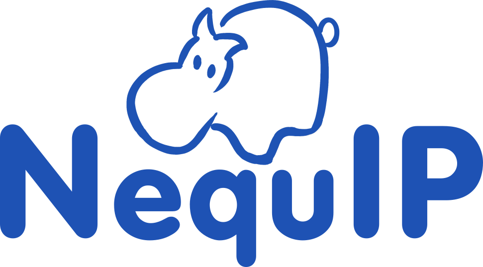

# NequIP

NequIP is an open-source code for building E(3)-equivariant interatomic potentials.

[](https://nequip.readthedocs.io/en/latest/?badge=latest)



**PLEASE NOTE:** the NequIP code is under active development and is still in beta versions 0.x.x. In general changes to the patch version (the third number) indicate backward compatible beta releases, but please be aware that file formats and APIs may change. Bug reports are also welcomed in the GitHub issues!

## Installation

NequIP requires:

* Python 3.10.20 with PyTorch 2.11.0+cu128 for CUDA 12.x/H100 systems. See the repository-root README and
  [`docs/INSTALL_CUDA128.md`](../../docs/INSTALL_CUDA128.md). Neither
  `torchvision` nor `torchaudio` is required.
* The public [T-e3nn](https://github.com/Hongyu-yu/T-e3nn) source, which
  installs as `e3nn==0.5.0+spin`. The repository-root README documents the
  offline-safe source installation command.

To install:

* We use [Weights&Biases](https://wandb.ai) to keep track of experiments. This is not a strict requirement — you can use our package without it — but it may make your life easier. If you want to use it, create an account [here](https://wandb.ai) and install the Python package:

  ```
  pip install wandb
  ```

* Install the SpinGNN NequIP fork from the SpinGNN repository root:

  ```bash
  python -m pip install ./src/core
  ```

  On an offline server where all supported runtime dependencies are already
  installed, use:

  ```bash
  python -m pip install --no-deps ./src/core
  ```

  The standard `nequip` package from PyPI does not contain the spin extensions
  in this directory.

### Installation Issues

The easiest way to check if your installation is working is to train a **toy** model:
```bash
$ nequip-train configs/minimal.yaml
```

If you suspect something is wrong, encounter errors, or just want to confirm that everything is in working order, you can also run the unit tests:

```
pip install pytest
pytest tests/unit/
```

To run the full tests, including a set of longer/more intensive integration tests, run:
```
pytest tests/
```

If a GPU is present, the unit tests will use it.

## Tutorial 

The best way to learn how to use NequIP is through the [Colab Tutorial](https://bit.ly/mrs-nequip). This will run entirely on Google's cloud virtual machine; you do not need to install or run anything locally. 

## Usage

**! PLEASE NOTE:** the first few calls to a NequIP model can be painfully slow. This is expected behaviour as the [profile-guided optimization of TorchScript models](https://program-transformations.github.io/slides/pytorch_neurips.pdf) takes a number of calls to warm up before optimizing the model. (The `nequip-benchmark` script accounts for this.)

### Basic network training

To train a network, you run `nequip-train` with a YAML config file that describes your data set, model hyperparameters, and training options. 

```bash
$ nequip-train configs/example.yaml
```

A number of example configuration files are provided:
 - [`configs/minimal.yaml`](configs/minimal.yaml): A minimal example of training a **toy** model on force data.
 - [`configs/minimal_eng.yaml`](configs/minimal_eng.yaml): The same, but for a **toy** model that predicts and trains on only energy labels.
 - [`configs/example.yaml`](configs/example.yaml): Training a more realistic model on forces and energies. **Start here for real models!**
 - [`configs/full.yaml`](configs/full.yaml): A complete configuration file containing all available options along with documenting comments. This file is **for reference**, `example.yaml` is the right starting point for a project.

Training runs can also be restarted by running the same `nequip-train` command if the `append: True` option is specified in the original YAML. (Otherwise, a new training run with a different name can be started from the loaded state of the previous run.)

All `nequip-*` commands accept the `--help` option to show their call signatures and options.

### Evaluating trained models (and their error)

The `nequip-evaluate` command can be used to evaluate a trained model on a specified dataset, optionally computing error metrics or writing the results to an XYZ file for further processing.

The simplest command is:
```bash
$ nequip-evaluate --train-dir /path/to/training/session/
```
which will evaluate the original training error metrics over any part of the original dataset not used in the training or validation sets.

For more details on this command, please run `nequip-evaluate --help`.

### Deploying models

The `nequip-deploy` command is used to deploy the result of a training session into a model that can be stored and used for inference.
It compiles a NequIP model trained in Python to [TorchScript](https://pytorch.org/docs/stable/jit.html).
The result is an optimized model file that has no dependency on the `nequip` Python library, or even on Python itself:
```bash
nequip-deploy build --train-dir path/to/training/session/ where/to/put/deployed_model.pth
```
For more details on this command, please run `nequip-deploy --help`.

### Using models in Python

An ASE calculator is also provided in `nequip.dynamics`.

### LAMMPS Integration 

Upstream NequIP provides LAMMPS integrations. In this SpinGNN distribution,
the bundled `pair_style nequip` and `pair_style spin/nequip_spin` include the
corrected local/ghost graph mapping, spin-force sign, and explicit LAMMPS PBC
input. They are validated for serial dense and sparse atom IDs, spin-force
finite differences, a 10-step `spin/sib` run, and single-node 2-rank parity on
CUDA 12.8. Multi-node parity is not yet validated. See
[`lammps/README.md`](../../lammps/README.md) for build, metadata, boundary, and
deterministic-inference requirements.

The historical upstream `pair_style nequip` workflow was:

1. Deploy a trained NequIP model, as discussed above.
```
nequip-deploy build path/to/training/session/ path/to/deployed.pth
```
The result is an optimized model file that has no Python dependency and can be used by standalone C++ programs such as LAMMPS.

2. Change the LAMMPS input file to the nequip `pair_style` and point it to the deployed NequIP model:

```
pair_style	nequip
pair_coeff	* * deployed.pth <NequIP type for LAMMPS type 1> <NequIP type for LAMMPS type 2> ...
```

The upstream [`pair_nequip` repository](https://github.com/mir-group/pair_nequip)
is separate from the corrected and validated bundled SpinGNN pair styles.


## References & citing

The theory behind NequIP is described in our preprint (1). NequIP's backend builds on e3nn, a general framework for building E(3)-equivariant neural networks (2). If you use this repository in your work, please consider citing NequIP (1) and e3nn (3):

 1. https://www.nature.com/articles/s41467-022-29939-5
 2. https://e3nn.org
 3. https://doi.org/10.5281/zenodo.3724963

## Authors

NequIP is being developed by:

 - Simon Batzner
 - Albert Musaelian
 - Lixin Sun
 - Anders Johansson
 - Mario Geiger
 - Tess Smidt

under the guidance of [Boris Kozinsky at Harvard](https://bkoz.seas.harvard.edu/).

## Contact, questions, and contributing

If you have questions, please don't hesitate to reach out at batzner[at]g[dot]harvard[dot]edu. 

If you find a bug or have a proposal for a feature, please post it in the [Issues](https://github.com/mir-group/nequip/issues).
If you have a question, topic, or issue that isn't obviously one of those, try our [GitHub Discussions](https://github.com/mir-group/nequip/discussions).

If you want to contribute to the code, please read [`CONTRIBUTING.md`](CONTRIBUTING.md).
